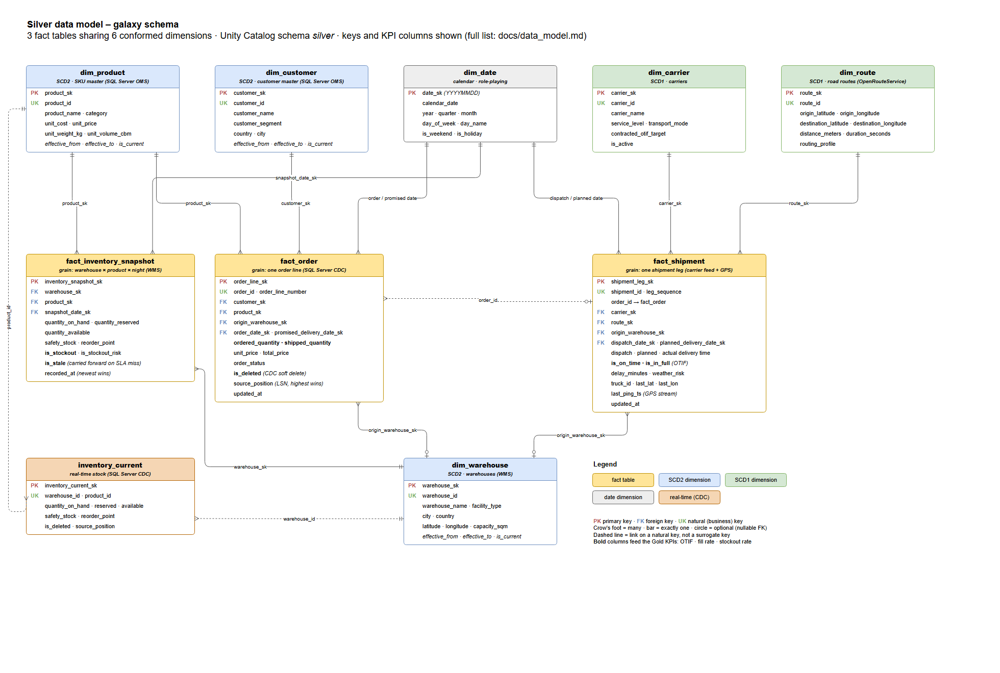

# Supply Chain Control Tower – Logistics Visibility on Azure Databricks


An end-to-end logistics data platform: orders, inventory, shipments, carrier APIs, database change
events (CDC) and truck GPS streams flow into a **medallion lakehouse** (Bronze → Silver → Gold) on
**Azure Databricks / Delta Lake / Unity Catalog**. Every record passes a **quality gate**: bad
rows are quarantined, fixed or replayed, never silently dropped. The result is a set of trusted
logistics KPIs: **OTIF, fill rate, stockout rate, inventory turnover and delivery-delay risk**.

> **Status:** the full pipeline is built and tested locally (238 automated tests, CI green).
> The Azure deployment (Terraform, Databricks Asset Bundles) is written and validated offline,
> and is deployed in a short cloud window before the demo.

---

## The problem

Logistics data is split across systems that never agree: the order system (OMS), the warehouse
system (WMS), carrier feeds, routing/weather APIs and GPS trackers. Teams find out about late or
short deliveries hours later, and reports break on unvalidated data. This platform brings all
sources into one governed lakehouse, checks every row, and publishes KPIs people can trust.

## Architecture

```
 Sources                       Bronze (raw Delta)       Quality gate          Silver (galaxy schema)     Gold
 ─────────────────────────     ──────────────────       ──────────────        ──────────────────────     ──────────────
 REST APIs (ORS, Open-Meteo) ─┐
 WMS nightly files ───────────┤ Auto Loader ─────────┐
 OMS master/order files ──────┘                      ├─► rules per feed ─┬─► 6 dims + 3 facts ──────► KPI views
 SQL Server OMS ── Debezium CDC ── Kafka/Event Hubs ─┤                   │   (SCD1 / SCD2)            + KPI mart
 Truck GPS / RFID ──────────────── Kafka/Event Hubs ─┘                   └─► quarantine ─► reprocess   ─► dashboards / Genie
```

Four ingestion patterns, one quality gate:

| Pattern | Sources | How |
|---|---|---|
| REST API | OpenRouteService (routes), Open-Meteo (weather) | Cached API pulls → landing files |
| Batch files | WMS inventory snapshots, master data, orders, shipments | Auto Loader → Bronze |
| CDC | SQL Server OMS (`order_lines`, `inventory`) | Debezium → Kafka / Event Hubs → Structured Streaming |
| Streaming | Truck GPS pings, pallet RFID scans | Kafka / Event Hubs → Structured Streaming |

Diagrams: [docs/architecture.md](docs/architecture.md) (flow, quarantine lifecycle, CDC path,
deployment) · editable slides version: [docs/architecture.drawio](docs/architecture.drawio).

## Data model

Silver is a **galaxy schema**: three fact tables sharing six conformed dimensions.



Full column list and notes: [docs/data_model.md](docs/data_model.md) · editable:
[docs/data_model.drawio](docs/data_model.drawio).

## KPIs (Gold)

| KPI | Definition | Built from |
|---|---|---|
| OTIF % | Delivered shipments on time (actual ≤ carrier ETA) **and** in full (shipped ≥ ordered) / delivered shipments | `fact_shipment` |
| Fill rate % | Units shipped / units ordered, over lines already shipped (open and cancelled lines excluded) | `fact_order` |
| Stockout rate % | SKUs with available quantity ≤ 0 / SKUs stocked; flagged `built_from_stale_data` after a WMS SLA miss | `fact_inventory_snapshot` |
| Inventory turnover | Annualised: trailing 30-day COGS / average inventory value × 365 / 30 | `fact_order`, `fact_shipment`, `fact_inventory_snapshot`, `dim_product` |
| Delivery-delay risk | Score 0–1 per in-flight shipment: 0.35 weather + 0.35 carrier unreliability + 0.20 route distance + 0.10 GPS staleness | `fact_shipment`, `dim_carrier`, `dim_route` |

The Gold SQL lives in [liquibase/changelog/gold/](liquibase/changelog/gold/) and is tested against an
independent calculation.

## Data quality and reliability

- **Quality gate:** every feed has its own rules (e.g. `RULE_ORDER_QUANTITY_POSITIVE`,
  `RULE_REF_INTEGRITY_WAREHOUSE`). A failing row goes to `quarantine.records` with the rule and reason.
- **Quarantine lifecycle:** `PENDING` → replayed every 2 hours → `REPROCESSED` once it passes (e.g.
  the late master data arrived) or `REJECTED` after the 7-day SLA. Data stewards can supply a
  `corrected_payload`; the original is never edited.
- **Silver quality tests:** ~50 whole-table checks (uniqueness, SCD2 history, referential
  integrity, business rules, quarantine rate, freshness) run before Gold. Any failure stops the
  run, so dashboards keep the last good numbers.
- **CDC correctness:** the highest log position (LSN) wins, so redelivered or out-of-order events cannot
  overwrite newer data. Deletes become soft deletes.
- **SLA and fallback:** the WMS file is due 02:00 UTC. On a miss, last night's stock is carried
  forward as `is_stale`, Gold flags `built_from_stale_data`, and an alert fires.
- **Observability:** `ops.pipeline_run_log`, `ops.sla_config` and four DQ tiles (volume vs
  quarantined, quarantine by rule, reprocessing success, pipeline SLA status).

Proven locally: GPS streaming with checkpoint resume; CDC snapshot, outage recovery and
out-of-order replay (60k-row reconciliation against SQL Server); reprocessing of 1,369
late-master-data lines; and the missing-WMS-night scenario.

## Tech stack

| Area | Technology |
|---|---|
| Lakehouse | Azure Databricks, Delta Lake, Unity Catalog, PySpark / Structured Streaming |
| Ingestion | Auto Loader, Debezium (Kafka Connect), Kafka locally / Azure Event Hubs in the cloud |
| Source systems | SQL Server (OMS with CDC), generated WMS/OMS/carrier data, ORS and Open-Meteo APIs |
| Schema management | Liquibase (Bronze/Silver tables and Gold views as versioned changesets) |
| Deployment | Databricks Asset Bundles (4 jobs × dev / qa / prod), Python wheel (`scm_platform`) |
| Infrastructure | Terraform (resource group, ADLS Gen2, Event Hubs, Key Vault, Databricks, Unity Catalog) |
| CI | GitHub Actions: ruff lint → 238 tests → wheel build |

## Repository layout

```
scm_platform/        pipeline code, packaged as a wheel: Bronze ingestion, Silver transforms,
                     GPS + CDC streams, quarantine reprocessing, SLA checks
data_generators/     synthetic data (master data, orders, inventory, shipments, GPS) and API seeding
databricks/          bundle jobs (resources/) and the SQL they run (sql/)
databricks.yml       Databricks Asset Bundle: variables, wheel artifact, dev / qa / prod targets
liquibase/           table migrations (changes/) and Gold KPI views (gold/)
dashboards/dq/       data-quality tile queries
cdc/                 SQL Server CDC setup and the Debezium connector config
local/               local runs: preview into SQL Server (preview/), Kafka + Debezium stack (streaming/)
infra/               Terraform for Azure
tests/               unit and Spark tests
docs/                architecture, data model, implementation notes, decisions
```

## Run it locally

**Prerequisites:** Python 3.11 and Java 17. SQL Server and Docker are only needed for the preview
and the streaming/CDC demos.

```powershell
pip install -r requirements-dev.txt

# Tests (fast + Spark, ~10 minutes)
python -m unittest discover -s tests -t .

# Generate synthetic data into data/
python -m data_generators.generate_master_data
python -m data_generators.generate_orders
python -m data_generators.generate_inventory
python -m data_generators.generate_shipments

# Run the whole pipeline locally and publish every layer to SQL Server (database scm_preview)
python -m local.preview.run_local_pipeline              # add --dry-run to skip SQL Server
python -m local.preview.run_local_pipeline --simulate-missing-wms-night   # SLA failure scenario
python -m local.preview.demo_reprocessing                # quarantine -> reprocessing demo
```

Streaming and CDC run in Docker (Kafka, Kafka Connect + Debezium, Spark). The CDC design and a
step-by-step demo are in [docs/cdc.md](docs/cdc.md). See also the usage notes at
the top of [local/streaming/docker-compose.yml](local/streaming/docker-compose.yml) and the SQL
Server CDC setup in [cdc/sqlserver/](cdc/sqlserver/). Secrets (`DEBEZIUM_SQL_PASSWORD`,
`ORS_API_KEY`) come from environment variables, never from files.

## Deploy to Databricks

One workspace, three environments separated by Unity Catalog catalog (`scm_platform_dev`,
`_qa`, `_prod`):

```powershell
databricks bundle validate -t dev
databricks bundle deploy   -t dev      # builds the wheel, deploys the 4 jobs
databricks bundle run      -t dev scm_daily_pipeline
```

| Job | Schedule (UTC) | Does |
|---|---|---|
| `scm_wms_sla_check` | 02:30 | Checks the WMS files arrived; carries forward stock and alerts if not |
| `scm_daily_pipeline` | 03:00 | Bronze ingest → Silver → Silver quality tests → Gold refresh |
| `scm_reprocess` | every 2 h | Replays pending quarantine rows |
| `scm_streaming` | every 30 min | Drains GPS and CDC events into Bronze (no cluster running 24/7) |

## Roadmap

- [x] Ingestion (4 patterns), quality gate, Silver galaxy schema, Gold KPIs
- [x] Quarantine lifecycle, Silver quality tests, SLA checks, DQ tiles
- [x] Wheel packaging, Asset Bundle, CI on GitHub Actions
- [ ] Failure scenarios: API retry with backoff, schema drift
- [ ] Per-environment Terraform catalogs and Liquibase runs; CD (dev → qa → approval → prod)
- [ ] Cloud deployment, Genie space over Gold, demo evidence

## Documented substitutions

| Charter | Used here | Why |
|---|---|---|
| Azure Event Hubs | Kafka locally; Event Hubs (Kafka endpoint) in the cloud | Same Kafka API, so the streaming code is unchanged |

## Documentation

- [docs/architecture.md](docs/architecture.md): architecture diagrams
- [docs/data_model.md](docs/data_model.md): ER diagrams and table notes
- [docs/01-project-overview.md](docs/01-project-overview.md): business context and objectives
- [docs/02-architecture.md](docs/02-architecture.md): component responsibilities
- [docs/03-implementation.md](docs/03-implementation.md): implementation log
- [docs/04-infrastructure.md](docs/04-infrastructure.md): Terraform deep-dive
- [docs/05-data-flow.md](docs/05-data-flow.md): ingestion pathways
- [docs/decisions.md](docs/decisions.md): architecture decision records
