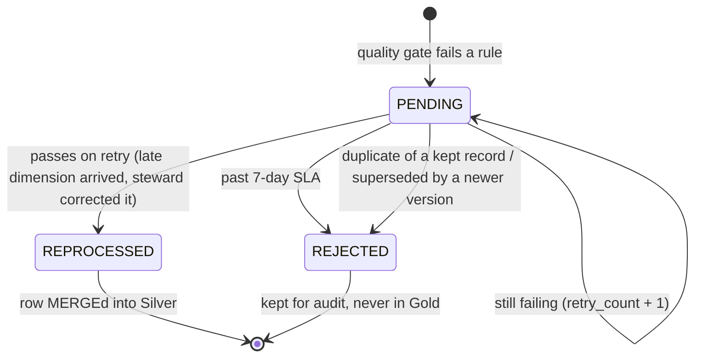
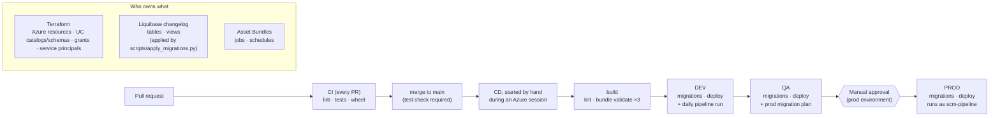

# Architecture — PS-02 Logistics Visibility Control Tower

Medallion lakehouse on Azure Databricks: four ingestion patterns land raw data in **Bronze**, a
per-feed **quality gate** sends clean rows to the **Silver** galaxy schema and failures to
**quarantine** (with a reprocessing loop), and **Gold** serves five KPIs to an AI/BI dashboard and
a Genie space. Unity Catalog governs everything; Terraform, Liquibase, Databricks Asset Bundles
and GitHub Actions deliver it as code.

The presentation version of the main diagram is [`architecture.drawio`](architecture.drawio)
(open in draw.io / diagrams.net or the VS Code *Draw.io Integration* extension; export PNG for slides).

## 1. End-to-end flow

```mermaid
flowchart LR
  subgraph SRC["Sources"]
    API["REST API<br/>OpenRouteService · Open-Meteo<br/>+ carrier shipments"]
    WMS["Batch file<br/>WMS nightly stock recon<br/>NDJSON, due 02:00 UTC"]
    OMS["CDC source<br/>SQL Server OMS<br/>orders + inventory"]
    GPS["Streaming<br/>GPS / RFID trucks + pallets"]
    MD["Master data<br/>warehouses · products<br/>customers · carriers"]
  end

  subgraph LAND["Landing / transport"]
    ADLS["ADLS Gen2<br/>/landing/&lt;feed&gt;/"]
    DBZ["CDC change tables<br/>→ Debezium<br/>(LSN bookmark)"]
    EH["Azure Event Hubs<br/>Kafka protocol<br/>(substitutes Kinesis)"]
  end

  subgraph BRZ["Bronze — Delta, append-only"]
    BF["routes · weather · shipments<br/>warehouses · products · customers · carriers"]
    BI["inventory<br/>+ WMS SLA check"]
    BC["orders_cdc · inventory_cdc<br/>op · before · after · source_position"]
    BG["gps_events (dedup event_id)"]
    DLQ["gps_events_dlq · cdc_dlq<br/>unparseable, verbatim"]
  end

  GATE{{"Quality gate<br/>one ordered rule list per feed<br/>keys · ranges · RI · duplicates<br/>CDC: highest LSN wins"}}
  Q[("quarantine.records<br/>PENDING → REPROCESSED / REJECTED")]
  RP["reprocess_quarantine<br/>every 2 h · same transforms<br/>7-day SLA"]

  subgraph SLV["Silver — galaxy schema"]
    DIM["6 conformed dimensions<br/>warehouse · product · customer (SCD2)<br/>carrier · route (SCD1) · date"]
    FACT["3 facts<br/>fact_order (CDC, soft deletes)<br/>fact_shipment (+ last GPS ping)<br/>fact_inventory_snapshot (is_stale)"]
    CUR["inventory_current<br/>real-time stock"]
  end

  subgraph GLD["Gold"]
    KPI["5 KPI views<br/>OTIF · fill rate · stockout rate<br/>inventory turnover · delay risk"]
    MART["mart_logistics_kpi_daily<br/>materialized view"]
  end

  subgraph CON["Consumption"]
    DASH["AI/BI dashboard<br/>KPI + data-quality tiles"]
    GENIE["Genie space<br/>natural language → SQL"]
  end

  API --> ADLS
  WMS --> ADLS
  MD --> ADLS
  ADLS -- "Auto Loader" --> BF
  ADLS -- "Auto Loader" --> BI
  OMS --> DBZ --> EH
  GPS --> EH
  EH -- "Structured Streaming<br/>checkpoints" --> BC
  EH -- "Structured Streaming<br/>checkpoints" --> BG
  EH -. "not JSON" .-> DLQ
  BF & BI & BC & BG --> GATE
  GATE -- PASS --> DIM
  GATE -- PASS --> FACT
  GATE -- PASS --> CUR
  GATE -- FAIL --> Q
  Q --> RP -- "healed → MERGE" --> FACT
  DIM --> KPI
  FACT --> KPI --> MART
  MART --> DASH
  MART --> GENIE
  KPI --> GENIE
  Q -. "DQ tiles" .-> DASH

  classDef src fill:#dae8fc,stroke:#6c8ebf,color:#000
  classDef land fill:#e1d5e7,stroke:#9673a6,color:#000
  classDef brz fill:#f5d6b4,stroke:#b46504,color:#000
  classDef gate fill:#fff2cc,stroke:#d6b656,color:#000
  classDef quar fill:#f8cecc,stroke:#b85450,color:#000
  classDef slv fill:#e6e6e6,stroke:#666,color:#000
  classDef gld fill:#ffe599,stroke:#bf9000,color:#000
  classDef con fill:#d5e8d4,stroke:#82b366,color:#000
  class API,WMS,OMS,GPS,MD src
  class ADLS,DBZ,EH land
  class BF,BI,BC,BG,DLQ brz
  class GATE gate
  class Q,RP quar
  class DIM,FACT,CUR slv
  class KPI,MART gld
  class DASH,GENIE con
```



**Cross-cutting**

| Concern | How |
|---|---|
| Governance | Unity Catalog: one catalog per environment, schemas per layer (`bronze`, `silver`, `gold`, `quarantine`, `ops`), group grants, row filter on the mart, column mask on `customer_id`, tags, automatic column lineage |
| Observability | `ops.pipeline_run_log`, `ops.sla_config`, four data-quality tiles: volume vs quarantined, quarantine by rule, reprocessing success rate, pipeline SLA status |
| Infrastructure | Terraform: resource group, ADLS Gen2, Event Hubs, Key Vault, Databricks workspace, access connector |
| Schema | Liquibase: versioned migrations for every table and view; Gold views redeploy on change |
| Jobs | Databricks Asset Bundles: ingestion, quality gate, Silver, Gold refresh, reprocessing, SLA sentinel |
| Delivery | GitHub Actions: lint → tests → bundle validate → deploy dev → QA → prod (manual approval) |
| Secrets | Azure Key Vault-backed secret scope; local runs use environment variables, never files |

## 2. The four ingestion patterns

| Pattern | Source (as built) | Transport → Bronze | Failure handling demonstrated |
|---|---|---|---|
| REST API | OpenRouteService routes, Open-Meteo weather; carrier shipments synthesised on the real shape | landing files → Auto Loader | retries with backoff; bad rows → quarantine |
| Batch file | WMS nightly stock reconciliation, NDJSON, one file per night | landing files → Auto Loader | late / missing file → SLA miss, last good snapshot carried forward (`is_stale`) |
| CDC | SQL Server OMS (`scm_oms`), CDC on `order_lines` and `inventory` | change tables → Debezium → Event Hubs → Structured Streaming | Debezium outage (resumes from LSN, nothing lost); out-of-order replay (highest LSN wins); reconciliation vs source = identical |
| Streaming | GPS/RFID producer, ~2,000 events/s | Event Hubs → Structured Streaming with checkpoints | unparseable → dead-letter table; duplicates removed on `event_id`; restart resumes at committed offsets |

## 3. Quarantine lifecycle



- Replays use the **same transform and rules** as the normal pipeline (one code path).
- A steward's fix goes into `corrected_payload`; `original_payload` is never edited.
- MERGE + freshness guard: a retried old record can never overwrite newer data.

## 4. CDC path in detail

Design decisions, failure scenarios and the local demo runbook: [cdc.md](cdc.md).

```mermaid
sequenceDiagram
  participant App as OMS application
  participant SQL as SQL Server (scm_oms)
  participant Agent as CDC capture job
  participant DBZ as Debezium (Kafka Connect)
  participant EH as Event Hubs / Kafka
  participant SS as Spark Structured Streaming
  participant BR as bronze.orders_cdc
  participant SV as silver.fact_order

  App->>SQL: UPDATE order_lines ... (one transaction)
  SQL->>Agent: transaction log entry (LSN)
  Agent->>SQL: row into cdc.dbo_order_lines_CT (before + after)
  DBZ->>SQL: poll changes after saved LSN
  DBZ->>EH: change event {op, before, after, source.commit_lsn, change_lsn}
  DBZ->>DBZ: save new LSN bookmark
  SS->>EH: read new offsets (checkpointed)
  SS->>BR: append event + source_position
  BR->>SV: highest source_position per key wins; op d → is_deleted
```

## 5. Deployment view



Every CD job logs in as the `scm-pipeline` service principal. The migration runner records applied
changesets in `ops.schema_changelog` per catalog, so a re-run only applies new ones. `scripts/up.ps1`
stores the session's values in GitHub; `scripts/github_envs.ps1` sets up the environments and the gate.

## 6. Substitutions (documented)

| Charter / guide | As built | Why |
|---|---|---|
| AWS Kinesis | Azure Event Hubs (Kafka protocol) | Stack 2 is Azure; local development uses Kafka, a configuration-only switch |
| FedEx / DHL / Maersk APIs | OpenRouteService + Open-Meteo | Commercial carrier APIs need accounts; real API shape, synthetic carrier fields |
| DLT expectations | PySpark rule lists per feed | Same rules for the gate, the reprocessing job and the tests; testable locally |
