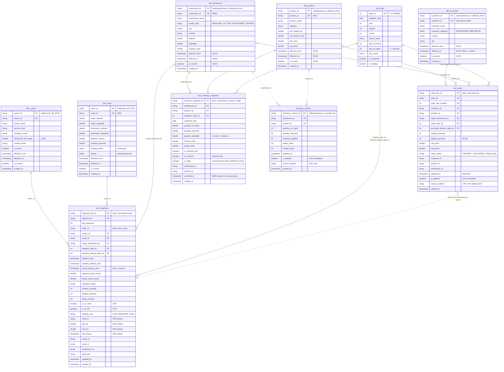
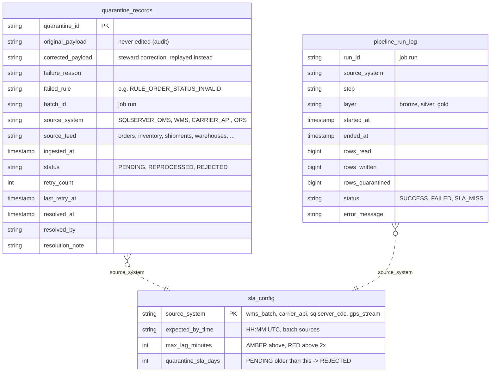

# Data model (ER diagrams)

Built from the Liquibase migrations (`liquibase/changelog/changes/001`–`015`), i.e. the tables as
deployed. GitHub renders the diagrams below directly.

- **Diagram 1 – Silver galaxy schema:** 3 fact tables sharing 6 conformed dimensions, plus the
  real-time `inventory_current`. This is what Gold reads.
- **Diagram 2 – Quarantine and ops:** the tables behind the quality gate, reprocessing and the DQ tiles.

Notation: `PK` primary key, `FK` foreign key, `UK` natural (business) key.
`||--o{` = one-to-many. Dotted lines (`..`) are links on a natural key, not on a surrogate key.

## 1. Silver galaxy schema

### How to read it

| Fact | Grain (one row per…) | Feeds the KPIs |
|---|---|---|
| `fact_order` | order line | Fill rate (`shipped_quantity / ordered_quantity`), turnover |
| `fact_shipment` | shipment leg | OTIF (`is_on_time`, `is_in_full`), delivery-delay risk (GPS + weather) |
| `fact_inventory_snapshot` | warehouse × product × night | Stockout rate, turnover, `built_from_stale_data` |
| `inventory_current` | warehouse × product (latest) | Real-time stock from CDC |

- **Galaxy (fact constellation), not a single star:** three facts share the conformed dimensions
  (`dim_warehouse`, `dim_product` and `dim_date` serve several facts), so KPIs from different
  facts line up by warehouse, product and day.
- **SCD2 dimensions** (`customer`, `product`, `warehouse`) keep history: a fact points at the
  dimension *version* valid when the event happened (point-in-time lookup), so a warehouse
  renamed today does not rewrite last month's KPIs. **SCD1** (`carrier`, `route`) overwrite in place.
- **`dim_date`** keys are `YYYYMMDD` integers; `fact_order` and `fact_shipment` each reference it twice
  (role-playing dimension: order vs promised date, dispatch vs planned delivery date).
- **Soft deletes:** a row deleted in SQL Server stays in Silver with `is_deleted = true` (audit);
  Gold excludes it.
- **`silver.weather`** (hourly Open-Meteo forecasts) is a supporting table with no foreign keys; its
  signal reaches the facts as `fact_shipment.weather_risk`.
- `silver.routes` / `silver.shipments` from migration 002 are legacy tables the pipeline no longer writes.

## 2. Quarantine and ops

In Unity Catalog these are `quarantine.records`, `ops.sla_config` and `ops.pipeline_run_log`
(Mermaid entity names cannot contain a dot). The quarantine rows link back to Silver through
`source_feed`. A healed row is merged into that feed's Silver table and marked `REPROCESSED`.
